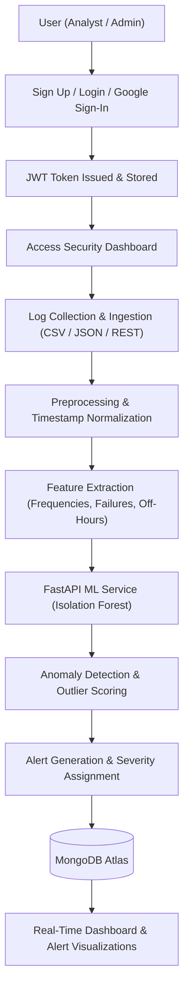

# Security Log Anomaly Detection System

> **NIIT University Capstone II Project**  
> A secure, end-to-end web application that ingests security logs, preprocesses them, extracts behavioral features, detects anomalies using an unsupervised **Isolation Forest** machine learning model, generates prioritized alerts, and visualizes incidents on an interactive security analyst dashboard.

---

## 1. System Architecture & Flow

The system operates across three core application tiers:
1. **Frontend Tier (React + Vite)**: Interactive Single Page Application providing analyst dashboards, authentication (local and Google Sign-In), log upload, and alert management.
2. **Backend API Gateway (Node.js + Express + MongoDB Atlas)**: Central orchestration service managing authentication (JWT, bcryptjs), log ingestion and storage, feature preprocessing, and alert lifecycle.
3. **Machine Learning Microservice (Python + FastAPI + scikit-learn)**: Dedicated asynchronous microservice performing feature extraction and outlier detection using the Isolation Forest algorithm.

### End-to-End System Flow


---

## 2. Fixed Technology Stack

The technology stack is fixed and strictly adheres to the project specification:

| Layer | Technology | Description |
| :--- | :--- | :--- |
| **Frontend** | React (Vite) | High-performance SPA with modern component architecture |
| **Backend** | Node.js + Express | RESTful API server, routing, and business logic orchestration |
| **Database** | MongoDB Atlas (Mongoose) | Managed cloud NoSQL database for logs, users, and alerts |
| **Authentication** | JWT + bcryptjs | Secure password hashing and stateless token authorization |
| **Federated Auth** | Google Sign-In | Google Identity Services (frontend) + `google-auth-library` (backend) |
| **ML Microservice** | Python 3.10+ & FastAPI | Asynchronous REST microservice for model inference |
| **Data & ML** | Pandas & scikit-learn | Dataframe manipulation and `IsolationForest` anomaly detection |
| **API Docs & QA** | Swagger & Postman | OpenAPI specs (`swagger-ui-express`) and Postman test collections |
| **Reverse Proxy** | Nginx | Reverse proxy, static asset delivery, and SSL termination |
| **Containerization** | Docker & Kubernetes (`k8s`) | Multi-stage container builds and Kubernetes cluster manifests |
| **CI/CD** | Jenkins | Automated testing, build, and deployment pipelines |

---

## 3. Project Directory Structure

```
final-capstone/
├── .antigravity/
│   └── rules                    # Agent workspace context lock & rules
├── .agents/
│   └── rules/
│       └── project_rules.md     # Hierarchical Antigravity rule definition
├── backend/                     # Node.js + Express API Gateway
│   ├── .env.example             # Backend environment template
│   └── .gitkeep
├── frontend/                    # React (Vite) Single Page Application
│   ├── .env.example             # Frontend environment template
│   └── .gitkeep
├── ml-service/                  # Python FastAPI ML Microservice
│   ├── .env.example             # ML service environment template
│   └── .gitkeep
├── tests/                       # Automated test suites and Postman collections
│   └── .gitkeep
├── docs/                        # Project documentation (SRS.docx, SDD.docx)
│   └── .gitkeep
├── nginx/                       # Nginx reverse proxy configuration
│   └── .gitkeep
├── k8s/                         # Kubernetes deployment & service manifests
│   └── .gitkeep
├── jenkins/                     # Jenkins CI/CD pipeline automation
│   └── .gitkeep
├── .env.example                 # Root environment template
├── .gitignore                   # Comprehensive Node, Python, and build ignore rules
├── AGENTS.md                    # Antigravity agent instructions and scope lock
├── GIT_WORKFLOW.md              # Git branching, commit conventions, and PR policy
├── JIRA_BACKLOG.md              # Full backlog with 9 Epics, User Stories, and Tasks
├── PROJECT_CONTEXT.md           # Source of truth scope and specification lock
└── README.md                    # Project documentation (this file)
```

---

## 4. Prerequisites

* **Node.js**: `v18.x` or higher
* **npm**: `v9.x` or higher
* **Python**: `v3.10` or higher
* **MongoDB**: Active MongoDB Atlas cluster or local MongoDB instance
* **Docker & Docker Compose** (Optional, for containerized local execution)
* **Google Cloud Console Account**: OAuth 2.0 Client ID for Google Sign-In

---

## 5. Local Development Setup

### 1. Clone & Configure Environment Variables
```bash
git clone <repository-url>
cd "final capstone"

# Copy root environment file
cp .env.example .env

# Configure backend environment
cp backend/.env.example backend/.env

# Configure frontend environment
cp frontend/.env.example frontend/.env

# Configure ML service environment
cp ml-service/.env.example ml-service/.env
```

### 2. Backend Setup (Node.js + Express)
```bash
cd backend
npm install
npm run dev
# Backend server runs on http://localhost:5000
# Swagger documentation available at http://localhost:5000/api-docs
```

### 3. Machine Learning Microservice Setup (Python + FastAPI)
```bash
cd ml-service
python -m venv venv

# Windows activate:
.\venv\Scripts\activate
# Linux/macOS activate:
# source venv/bin/activate

pip install -r requirements.txt
uvicorn main:app --host 0.0.0.0 --port 8000 --reload
# ML API runs on http://localhost:8000
# Interactive FastAPI Swagger docs at http://localhost:8000/docs
```

### 4. Frontend Setup (React + Vite)
```bash
cd frontend
npm install
npm run dev
# Frontend application accessible at http://localhost:3000
```

---

## 6. Environment Variables Reference

### Backend (`backend/.env`)
* `PORT`: Port for the Express server (default: `5000`).
* `NODE_ENV`: Runtime environment (`development` | `production`).
* `MONGODB_URI`: MongoDB Atlas connection string.
* `JWT_SECRET`: Cryptographic secret key used to sign and verify JSON Web Tokens.
* `JWT_EXPIRES_IN`: Lifetime of issued tokens (e.g., `7d`, `24h`).
* `GOOGLE_CLIENT_ID`: OAuth 2.0 client ID from Google Cloud Console.
* `ML_SERVICE_URL`: Base HTTP URL of the Python FastAPI microservice (`http://localhost:8000`).
* `CLIENT_ORIGIN`: Allowed CORS origin for the React client (`http://localhost:3000`).
* `LOG_LEVEL`: Logging verbosity (`debug`, `info`, `warn`, `error`).

### Frontend (`frontend/.env`)
* `VITE_PORT`: Vite local development port (`3000`).
* `VITE_API_URL`: Backend API endpoint base URL (`http://localhost:5000/api`).
* `VITE_GOOGLE_CLIENT_ID`: Google OAuth 2.0 client ID for Google Identity Services.

### ML Microservice (`ml-service/.env`)
* `ML_HOST`: Binding host (default: `0.0.0.0`).
* `ML_PORT`: Binding port (default: `8000`).
* `MODEL_PATH`: Filesystem path to serialized Isolation Forest model artifact.
* `CONTAMINATION_RATE`: Expected proportion of outliers in the data (default: `0.05`).
* `RANDOM_STATE`: Random seed for reproducible training results (default: `42`).

---

## 7. API Documentation & Testing

* **Backend Swagger OpenAPI**: Accessible at `http://localhost:5000/api-docs` when the backend is running.
* **ML Microservice Swagger Docs**: Accessible at `http://localhost:8000/docs`.
* **Postman Collection**: Pre-configured test suites with automated token injection are located in `tests/postman/`.

---

## 8. Git Workflow & Collaboration

All project contributions must follow the standards outlined in [GIT_WORKFLOW.md](GIT_WORKFLOW.md):
* **Branches**: `main` (production), `develop` (staging/integration), `feature/<jira-key>-<name>`.
* **Commit Format**: `<JIRA-KEY>: <type>(<scope>): <subject>` (e.g., `SLAD-101: feat(auth): implement Google OAuth validation`).
* **Pull Requests**: All features merge into `develop` through peer-reviewed PRs adhering to the PR security checklist.


---

## 10. Assumptions

1. **Log Data Format**: Ingested security logs follow standard authentication and network access attributes (`timestamp`, `sourceIp`, `destinationIp`, `username`, `eventType`, `status`, `port`, `message`).
2. **Isolation Forest Model**: Anomaly detection utilizes `sklearn.ensemble.IsolationForest` with default contamination rate `0.05`.
3. **User Roles**: The system implements two access roles: `Analyst` (log ingestion, alert inspection, status updates) and `Admin` (full system access including user administration).
